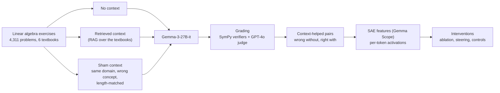

# Does retrieval switch on reasoning subroutines?

Research code from Columbia's CRIS Lab (Complex Resilient Intelligent Systems) studying **why retrieval-augmented generation helps an LLM do math**, using sparse autoencoder (SAE) features and causal interventions on **Gemma-3-27B-it**.

**Hypothesis.** On some linear-algebra problems, retrieved textbook context helps because it activates sparse internal features tied to reusable reasoning routines, such as building a generalized eigenvector or a nilpotent operator, and those features are causally important for getting the answer right.

**Status:** research in progress. This repository contains the core pipeline modules; the dataset and run outputs are not included.

## Experimental design



1. **Three context conditions per problem.** No context; retrieved textbook context (embedding search with a leakage filter so the answer can't be copied from the passage); and a **sham** context drawn from the same textbooks but about a different concept, length-matched to control for token count and style.
2. **Task families.** Problems are grouped into 15 families that should share one computational subroutine, for example generalized eigenvector construction, nilpotent construction, characteristic and minimal polynomials, diagonalization and Jordan bases. Causal claims are made per family. See [`configs/task_families.yaml`](configs/task_families.yaml).
3. **Grading.** Construction problems are checked exactly with SymPy verifiers (for example, that a returned matrix really is k-nilpotent). Everything else goes to a GPT-4o judge. Accuracy differences are reported with bootstrap confidence intervals and Fisher's exact test.
4. **Feature discovery.** For problems the model gets wrong without context and right with it, we record per-token SAE activations over the generated tokens and rank features by effect size between the paired runs.
5. **Causal tests, in both directions.**
   - **Ablation:** project activations into SAE space, zero the candidate features, decode back, and let the model continue. This is done at decode only, or at prompt and decode, for single features and combined sets, and at partial strengths.
   - **Steering:** add the candidate feature directions at several strengths.
   - **Controls:** random SAE features matched on activation magnitude, top non-candidate features, features from a different family, a plain activation-steering vector, and linear probes on raw activations and SAE space.

## What we've found so far

One candidate feature passed **ablation** and **differential-activation** tests: removing it hurt its task family, and it fired differently with retrieval than without. It then **failed a pre-registered steering-specificity test**: turning it up did not specifically produce the behavior.

We read this through the necessity-versus-sufficiency asymmetry discussed by Makelov et al. A feature can be necessary for a behavior without being sufficient to cause it on its own. Pre-registering the steering test is what made that distinction visible instead of letting ablation alone tell the story.

## Repository layout

```
configs/task_families.yaml   Task-family taxonomy: subroutine, keywords, chapters
contexts/
  corpus.py                  Textbook corpus and chunking
  embed.py                   Embeddings for retrieval
  rag.py                     Retrieval with answer-leakage filtering
  sham.py                    Same-domain, wrong-concept sham contexts
eval/
  sympy_verifier.py          Exact checks for construction problems
  axler_char_poly_verifier.py
  judge_gpt4o.py, judge_gpt4o_sync.py, judge_router.py
                             Route to exact verification or the LLM judge
  metrics.py                 Accuracy by condition, bootstrap CIs, Fisher's exact test
interventions/
  sae_hook.py                SAE encode, edit features, decode, as a forward hook
  activation_steering.py     Raw activation-steering baseline
  build_specs.py             Intervention specs (features, stage, strength)
experiment setup             Working design notes
```

## Stack

Python, PyTorch, Hugging Face Transformers, Gemma Scope SAEs (via SAE-Lens), SymPy, OpenAI embeddings and GPT-4o as judge. Runs on a Slurm GPU cluster.

## Author

Henry He, AI Research Engineer at the CRIS Lab, Columbia University.
